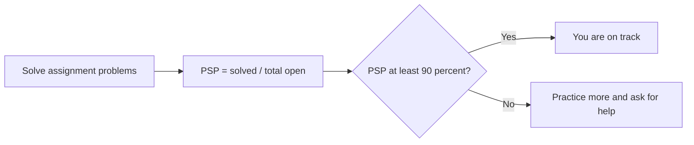
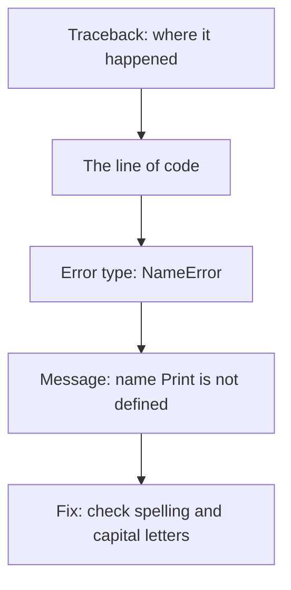
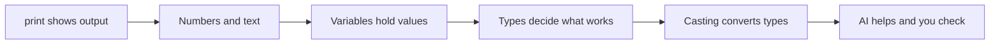

# Introduction to Python and Data Types, with AI Awareness

**Program:** DevOps & Cloud  |  **Track:** Core & Electives Track  |  **Module:** Beginner Python  |  **Class:** 1 (first class of the program)  |  **Duration:** 90 minutes  |  **Format:** Live, online

**Level:** Beginner. No coding experience is assumed. Everything is taught from zero.  
**Running example:** a server and its name, disk and CPU, so every idea connects to DevOps.

---

## Read this first (for the instructor)

- Text in normal type is what you **say**. Lines that start with `> **Ask in chat**` or `> **Predict**` are questions to the learners: ask them, then **wait**. Lines in *[square brackets and italics]* are things you **do**, not say.
- Every line of code in this script was run before it was written here. The output shown under each code block is the real output.
- Learners answer in chat. There is no show of hands in an online class. Read some replies out loud every time, and use names.
- Where you see `[[FROM_SME: ...]]` a fact was not available to the script writer. Fill it in before class (the list is at the end).

**Class plan**

1. How this program runs: PSP, attendance, contests and where to ask for help
2. Your first Python program: print and exact instructions
3. Reading an error and why capital letters matter
4. Numbers and text: arithmetic, joining text, comments
5. Variables, types and type casting
6. AI in your coding journey

**Visuals in this class (Beginner level: 10 visuals)**

- **V01** · diagram · after card 3: How PSP is worked out (made by Gemini)
- **V02** · animation · after card 5: The computer follows exactly what you write (made by Claude)
- **V03** · diagram · after card 7: The parts of a Python error (made by Gemini)
- **V04** · animation · after card 9: Arithmetic and the difference between / and // (ready-made Scaler animation)
- **V05** · animation · after card 11: Joining text and spaces (ready-made Scaler animation)
- **V06** · animation · after card 12: Variables as labels (ready-made Scaler animation)
- **V07** · animation · after card 12: Detecting the type of a value (ready-made Scaler animation)
- **V08** · animation · after card 14: Type casting step by step (ready-made Scaler animation)
- **V09** · animation · after card 15: Why fundamentals matter (ready-made Scaler animation)
- **V10** · diagram · after card 17: The mental model of today's class (made by Gemini)

---

## Card 1 · Before you start

*Instructor note · 2 min*

> **For you, the instructor:** Open Google Colab in one tab and keep the PSP and attendance screenshot ready on your tablet. Greet people as they join, speak slowly, and wait for chat replies, because many learners have never written code.

---

## Card 2 · Welcome and agenda

*Agenda · 3 min*

Hey everyone, welcome to your first session at Scaler!

I am really glad you are here. Before we start, I want to know who is in this room.

> **Ask in chat:** Type two lines about yourself. Your name, where you are from, and one thing you want to build with Python or in DevOps.

*[Pause 30 seconds. Read three or four replies out loud and react to each one.]*

Now a quick word about me. [[FROM_SME: instructor introduction, name, years of experience, LinkedIn link]]. I have sat exactly where you are sitting. I will make this simple, I promise.

Here is our plan for the next 90 minutes.

1. How this program runs: PSP, attendance, contests, and where to ask for help.
2. Your first Python program.
3. How to read an error, and why capital letters matter.
4. Numbers and text.
5. Variables and types.
6. AI in your coding journey.

> **Key:** By the end of today you will have written and run real Python, and you will know how this program works.

> **Ask in chat:** Type 1 if you have never written code. Type 2 if you have written a little. Type 3 if you code every week.

*[Read the split out loud. Say: "Perfect. Today starts from zero, so nobody is behind."]*

---

## Card 3 · How this program runs: PSP, attendance and contests

*Concept · 7 min*

Let me explain three words you will hear every week: PSP, attendance, and contests.

> **Ask in chat:** What do you think PSP stands for? Guess. A wrong guess is fine.

*[Pause 20 seconds. Read two guesses.]*

PSP means Problem Solving Percentage. It tells you how much of your homework you have actually done.

The formula is simple. Take the assignment problems you have solved. Divide by all the assignment problems that are open. That is your PSP.

Here is a quick example. Say 18 assignment problems are open and you have solved 16. Then 16 divided by 18 is about 89 percent. That is just under the line. One more solved problem, 17 out of 18, would put you at about 94 percent.

> **Key:** Your target is a PSP of at least 90 percent. Only assignment problems count. Extra problems do not count, but I recommend them, because practice is how you get good.

Next, attendance. Please aim for at least 90 percent. You can attend live or watch the recording. Live is better, because you can ask questions and get answers right away.

If you miss a class, message the WhatsApp group and tell us why. We will reach out if we see your numbers dip, and that is only to help you.

Last one, contests. Each contest runs live for two days. You get 5 coding questions and 5 multiple choice questions. You have 2 hours. There is no pass or fail. A contest simply shows you where you stand.

> **Ask in chat:** In one word, which of the three feels hardest to keep up: PSP, attendance, or contests?

*[Read the answers. Say: "Good to know. That is exactly what the community groups are for."]*

Why does this matter? Because people who keep their PSP and attendance up almost always finish the program strong. The numbers are a mirror, not a punishment.

> **Visual V01 · diagram (made by Gemini) · How PSP is worked out**  
> *Shows:* Show PSP as a short flow: solved assignment problems divided by total open assignment problems, then a check against 90 percent, with one path for on track and one for practice more and ask for help.  
> *Serves:* How this program runs: PSP, attendance, contests



---

## Card 4 · This module, common questions, and where to get help

*FAQ · 6 min*

Now, what are we learning in this module?

This is Beginner Python. We start from zero and move step by step. The topics are: Python basics and data types today, then operators and control statements, loops, functions, lists, tuples and strings, regex, sets and dictionaries, file and exception handling, interview problems, and the DevOps-Python full syllabus contest at the end. [[FROM_SME: the full list of all 14 module topics from the curriculum]]

You will not become a developer this week. You will learn to think clearly in code, and that is the base for every DevOps tool you use later.

> **Ask in chat:** Type YES if you are okay with a slow start. Type NO if you want it faster. I will adjust.

*[Pause 20 seconds. Read the split.]*

Here are the questions people ask most.

**Where are my notes?** Notes are uploaded after each class.

**When do assignments open?** The moment class ends. There is no deadline for assignments, but please do them soon while the class is fresh.

**Where do I ask questions?** Ask in the public chat so everyone learns from your question. I can answer in the private chat if it is personal.

**When do batches run?** [[FROM_SME: batch timings and break times for this program]]

**Who do I contact if something is broken?** [[FROM_SME: support contact or email for this program]]

> **Key:** If you are stuck, ask early. Post in the WhatsApp or Slack group, and help each other too. Teaching someone else is the fastest way to learn.

> **Ask in chat:** Any question so far? Type it now, or type "all good".

*[Answer two or three questions. Then say: "Now let us write code."]*

---

## Card 5 · Your first Python program

*Walkthrough · 8 min*

A computer is very literal. It does exactly what you tell it, and nothing more. It cannot guess what you meant.

That is why we write instructions in a language it understands. Today's language is Python.

We will use Python 3, inside Google Colab. Colab chooses the exact version for you, and everything we do today works on any recent Python 3 version.

Let us open Google Colab. Open your browser, search for Colab, open the first link, and click New notebook. You will see a box. That box is called a cell. You type code in it and press the play button.

Here is our first program. Type it with me, one line at a time. Do not copy and paste. Typing teaches your fingers.

```python
print("Hello, DevOps world!")
print("10")
print(10)
print(10 + 20)
```

`print` is a command. It shows whatever you give it on the screen. The thing inside the brackets is what gets shown.

> **Ask in chat:** Run it. Then type what appeared on your screen.

*[Pause 45 seconds. Read a few replies. If someone sees an error, ask them to paste it. That becomes the next card.]*

> **Predict:** Look at line 2 and line 3. One has quotes around the 10 and one does not. Will they look the same on the screen? Type SAME or DIFFERENT.

*[Pause 15 seconds.]*

Reveal: They look the same. Both print 10. But they are not the same thing. The one in quotes is text, like a word. The one without quotes is a real number. The last line shows why that matters. `10 + 20` gives 30, because Python adds numbers.

> **Key:** Text goes inside quotes. Numbers do not. Python treats them differently.

Why does this matter? In DevOps you will print server names, which are text, and server counts, which are numbers. Mixing them up is the most common beginner mistake, and we will meet it again in a minute.

**What you will see (real output):**

```text
Hello, DevOps world!
10
10
30
```

> **Visual V02 · animation (made by Claude) · The computer follows exactly what you write**  
> *Shows:* A step-by-step animation of one instruction going in and one result coming out: the learner types print with a message, Python reads it, and the screen shows the message. Add a second run with a tiny typing mistake to show that the computer cannot guess what you meant. Use a server and a terminal as the picture.  
> *Serves:* Your first Python program: print and exact instructions

**Sources** (each page was fetched and checked against the claim)

- ✅ checked: Python documentation: built-in function print. print() prints objects to the text stream, separated by sep and followed by end  
  https://docs.python.org/3/builtins/functions.html  
  The page says: “Print objects to the text stream file, separated by sep and followed by end. sep, end, file, and flush, if present, must be given as keyword arguments.”

---

## Card 6 · Quiz 1: what will print?

*Quiz · 3 min*

Quick check. I will read the question, you get 30 seconds, then type A, B, C or D in chat.

I will not tell you the answer until most of you have replied. Then we will go through every option together, including the wrong ones.

**Question**

What will this code print?

```python
print(10 + 20)
```

- **A)** 30  ✅ correct
- **B)** 10 + 20
- **C)** 1020
- **D)** An error

**Say after the answers are in:** The answer is **A**. Python adds the two numbers and prints the result, 30. Numbers without quotes are added.

**Why each wrong option is wrong**

- **B)** That would be true only if 10 + 20 were inside quotes, because then it is just text.
- **C)** That joins two pieces of text side by side. These are numbers, so they are added.
- **D)** The code is correct. print is spelled right, the brackets match, and adding numbers is allowed.

---

## Card 7 · Reading an error, and why capital letters matter

*Concept · 5 min*

Everybody makes errors. Professionals make them all day. The skill is reading them calmly.

Let me break something on purpose, in the same Python 3 version you used a moment ago. Type this, with a capital P, and run it.

```python
Print("Hello")
```

> **Ask in chat:** What did you see? Type the last line of the red message.

*[Pause 30 seconds. Read a reply aloud.]*

You should see `NameError: name 'Print' is not defined`.

Read it from the bottom up. The last line tells you the type of error and what is wrong. Here it says Python does not know a name called Print.

Why? Because Python cares about capital letters. `print` and `Print` are two different names. Python knows `print`. It has never heard of `Print`.

> **Key:** Python is case sensitive. `print` works. `Print` and `PRINT` do not.

Why does it matter? In DevOps, a wrong capital letter in a command or a file name can break a deployment. The habit of reading the last line first will save you hours.

> **Ask in chat:** Fix it and run it again. Type DONE when it prints.

*[Wait for DONE replies. Praise the first few by name.]*

Two other errors you will meet soon. A missing bracket gives a `SyntaxError`, which means the sentence is not shaped correctly. Mixing text and numbers the wrong way gives a `TypeError`. We will see that one in a few minutes.

**What you will see (this one is meant to fail with `NameError`):**

```text
NameError: name 'Print' is not defined
```

*In Colab the red lines above this one look different. Always read the last line first, as the card teaches.*

> **Visual V03 · diagram (made by Gemini) · The parts of a Python error**  
> *Shows:* Show a Python error message broken into its parts, top to bottom: where it happened, the line of code, the error type, the message, and what to check first.  
> *Serves:* Reading an error and why capital letters matter



**Sources** (each page was fetched and checked against the claim)

- ✅ checked: Python documentation: built-in exceptions NameError. NameError is raised when a name is not found  
  https://docs.python.org/3/builtins/exceptions.html  
  The page says: “Raised when a local or global name is not found. This applies only to unqualified names. The associated value is an error message that includes the name that could not be found.”

---

## Card 8 · Quiz 2: spot the error

*Quiz · 3 min*

Another quick one. Read it, think for 30 seconds, then answer in chat.

**Question**

What happens when you run this code?

```python
Print(5 * 10)
```

- **A)** It prints 50
- **B)** It prints Print(5 * 10)
- **C)** It prints nothing and shows no error
- **D)** It shows an error  ✅ correct

**Say after the answers are in:** The answer is **D**. Python is case sensitive. It does not know the name Print, so it stops with a NameError.

**Why each wrong option is wrong**

- **A)** That would happen with a lowercase print. The capital P changes everything.
- **B)** Python only prints text that is inside quotes. Here nothing is in quotes.
- **C)** A name Python does not know always raises an error. It never fails quietly here.

---

## Card 9 · Numbers: the basic operations

*Walkthrough · 8 min*

Python is a very good calculator. Let us use it like a DevOps engineer.

Picture a disk with 60 gigabytes in total. 45 gigabytes are used. We want to know how full it is.

Type these and run them.

```python
print(45 + 5)
print(60 - 45)
print(45 * 2)
print(45 / 60 * 100)
print(60 / 2)
print(7 / 2)
print(7 // 2)
print(2 ** 10)
```

The signs are: plus to add, minus to subtract, star to multiply, slash to divide, and two stars for power.

Look at line 4. 45 divided by 60, times 100, gives 75.0. So the disk is 75 percent full. That is a real DevOps calculation.

> **Ask in chat:** Now try it yourself. Change line 4 so the disk has 80 gigabytes in total and 20 are used. Run it, and type the answer.

*[Pause 30 seconds. The answer is 25.0. Read a few replies and praise anyone who got it.]*

> **Ask in chat:** Type what line 5 printed. Did it print 30 or 30.0?

*[Pause 20 seconds.]*

It printed 30.0. The slash always gives a number with a decimal point, even when the answer is whole. Remember that, because it surprises everyone once.

> **Predict:** Line 6 is 7 divided by 2 with one slash. Line 7 is 7 divided by 2 with two slashes. What will each print? Type your two answers.

*[Pause 30 seconds. Read three guesses.]*

Reveal: One slash gives 3.5, the exact answer. Two slashes give 3. Two slashes mean floor division, which means divide and then throw away the part after the decimal point.

> **Key:** `/` gives the exact answer with a decimal point. `//` gives only the whole part.

Why does it matter? Say you have 7 jobs and 2 servers. The slash tells you 3.5 jobs each, which makes no sense for jobs. Two slashes tell you 3 whole jobs each, with one left over. In scaling work you will use both.

The last line, `2 ** 10`, gives 1024. Two stars mean power. It means ten twos multiplied together. You will meet 1024 everywhere in computing.

We will cover more operators, like comparing and combining conditions, in the next class. Today we only need these five.

**What you will see (real output):**

```text
50
15
90
75.0
30.0
3.5
3
1024
```

> **Visual V04 · animation (ready-made Scaler animation) · Arithmetic and the difference between / and //**  
> *Shows:* The existing Scaler animation for arithmetic, including divide versus floor divide.  
> *Serves:* Numbers and text: arithmetic  
> *Play it:* https://scaler-mk.github.io/algo-visualizer/Animation_1_Arithmetic.html

**Sources** (each page was fetched and checked against the claim)

- ✅ checked: Python tutorial: numbers. Division with / always returns a float, and // does floor division  
  https://docs.python.org/3/tutorial/introduction.html  
  The page says: “Division (/) always returns a float. To do floor division and get an integer result you can use the // operator; to calculate the remainder you can use %:”
- ✅ checked: Python tutorial: numbers. the ** operator calculates powers  
  https://docs.python.org/3/tutorial/introduction.html  
  The page says: “With Python, it is possible to use the ** operator to calculate powers [1]:”

---

## Card 10 · Quiz 3: two slashes

*Quiz · 3 min*

One more. This one catches a lot of people, so think carefully.

**Question**

What will this code print?

```python
print(7 // 2)
```

- **A)** 3.5
- **B)** 3  ✅ correct
- **C)** 4
- **D)** 3.0

**Say after the answers are in:** The answer is **B**. Two slashes divide and keep only the whole part. 7 divided by 2 is 3 with a remainder, so the answer is 3.

**Why each wrong option is wrong**

- **A)** 3.5 is what one slash gives. Two slashes drop the decimal part.
- **C)** Floor division never rounds up. It always rounds down to the whole part.
- **D)** The result is a whole number, so there is no decimal point.

---

## Card 11 · Text, joining text, and comments

*Walkthrough · 6 min*

Text in Python is called a string. A string is anything inside quotes.

You can join two strings with a plus sign. This is called concatenation, which is a big word for gluing text together.

Type this and run it. The first line starts with a hash sign. That is a comment. Python ignores it completely. It is a note for humans.

```python
# Join text with +
print("Server: " + "web-01")
print("Server:", "web-01")
print("Servers up:", 3)
print("10" + "20")
print("a", "b", "c", sep="-")
```

> **Ask in chat:** Type what you see for line 5. Is it 30 or 1020?

*[Pause 20 seconds.]*

It is 1020. With quotes, those are strings, so plus glues them together and does not add them. Remember our first program? Quotes make text.

> **Ask in chat:** Now make it yours. Change `web-01` in line 2 to your own name, run it, and type what you see.

*[Pause 30 seconds. Read three results out loud, using the learners' names.]*

Now compare the first two print lines. The plus sign glues text exactly as written, with no space added. The comma version adds a space for you. And the comma also lets you mix text and a number, as in `Servers up: 3`.

If you try to glue text and a number with a plus, like `"Total: " + 5`, Python stops with a TypeError. It cannot join text and a number. Use a comma instead, or turn the number into text. We will see how in the casting card.

The last line shows `sep`. It changes the glue between items. Here the glue is a dash, so you get `a-b-c`.

> **Key:** Plus glues strings together. A comma in print adds a space and allows numbers. Hash starts a comment.

Why use comments? In a week you will forget why you wrote a line. Your team will not know either. A short comment fixes both problems.

**What you will see (real output):**

```text
Server: web-01
Server: web-01
Servers up: 3
1020
a-b-c
```

> **Visual V05 · animation (ready-made Scaler animation) · Joining text and spaces**  
> *Shows:* The existing Scaler animation for string concatenation and spaces.  
> *Serves:* Numbers and text: joining text  
> *Play it:* https://scaler-mk.github.io/algo-visualizer/Animation_2_StringConcat.html

**Sources** (each page was fetched and checked against the claim)

- ✅ checked: Python tutorial: an informal introduction (comments). Comments in Python start with the hash character and extend to the end of the line  
  https://docs.python.org/3/tutorial/introduction.html  
  The page says: “Comments in Python start with the hash character, #, and extend to the end of the physical line.”
- ✅ checked: Python tutorial: an informal introduction (text). Strings can be concatenated with the + operator  
  https://docs.python.org/3/tutorial/introduction.html  
  The page says: “Strings can be concatenated (glued together) with the + operator, and repeated with *:”

---

## Card 12 · Variables and types

*Concept · 9 min*

So far we typed the same values again and again. A variable lets you store a value and use it later by name.

Think of a variable as a label. You stick a label on a value. The label is the name. The value is whatever the label points to.

Here is our server, described in four variables.

```python
server = "web-01"
cpu_percent = 72
load = 0.85
is_running = True
print(server, type(server))
print(cpu_percent, type(cpu_percent))
print(load, type(load))
print(is_running, type(is_running))
cpu_percent = 80
print(cpu_percent)
```

The equals sign here is not maths. It means: put this label on that value.

> **Ask in chat:** Run it. Type the type of the second line, the one for cpu_percent.

*[Pause 30 seconds. Read two replies.]*

You will see four types. `str` is text. `int` is a whole number. `float` is a number with a decimal point. `bool` is true or false, and it always starts with a capital letter, `True` or `False`.

> **Key:** The type decides what you can do. You can add two numbers. You can glue two strings. You cannot freely mix them.

Look at the last two lines. We moved the label `cpu_percent` from 72 to 80. The label is the same, the value changed.

Now, how do we name things? There are simple rules.

A name can have letters, digits and underscores. It cannot start with a digit. It cannot have spaces or signs like a percent. It is case sensitive, so `Server` and `server` are different. And the style Python people use is lowercase words joined with an underscore, like `cpu_percent`.

> **Ask in chat:** I want to store the number of servers. Suggest a good variable name in chat.

*[Read three names. Praise the ones that use lowercase and underscores. Gently fix any with spaces.]*

Why does it matter? Good names make code readable. `cpu_percent` tells you everything. `x` tells you nothing, and you will not remember it next week.

**What you will see (real output):**

```text
web-01 <class 'str'>
72 <class 'int'>
0.85 <class 'float'>
True <class 'bool'>
80
```

> **Visual V06 · animation (ready-made Scaler animation) · Variables as labels**  
> *Shows:* The existing Scaler animation that shows a variable as a label pointing at a value, not a box.  
> *Serves:* Variables, types and type casting  
> *Play it:* https://scaler-mk.github.io/algo-visualizer/Animation_4_VariablesAsLabels.html

> **Visual V07 · animation (ready-made Scaler animation) · Detecting the type of a value**  
> *Shows:* The existing Scaler animation that detects the type of a value.  
> *Serves:* Variables, types and type casting  
> *Play it:* https://scaler-mk.github.io/algo-visualizer/Animation_3_TypeDetector.html

**Sources** (each page was fetched and checked against the claim)

- ✅ checked: PEP 8 style guide: naming conventions. function and variable names should be lowercase with words separated by underscores  
  https://peps.python.org/pep-0008/  
  The page says: “Function names should be lowercase, with words separated by underscores as necessary to improve readability.”
- ✅ checked: Python documentation: built-in function type. type() with one argument returns the type of an object  
  https://docs.python.org/3/builtins/functions.html  
  The page says: “With one argument, return the type of an object. The return value is a type object and generally the same object as returned by object.__class__.”

---

## Card 13 · Quiz 4: a good variable name

*Quiz · 3 min*

Last quiz of the first half. Pick the one name Python accepts.

**Question**

Which of these is a valid variable name?

- **A)** server_1  ✅ correct
- **B)** 1_server
- **C)** my server
- **D)** cpu%

**Say after the answers are in:** The answer is **A**. server_1 uses letters, a digit that is not at the start, and an underscore, so Python accepts it.

**Why each wrong option is wrong**

- **B)** A name cannot start with a digit. Python reads 1_server as a mistake.
- **C)** A name cannot have a space. Use an underscore, as in my_server.
- **D)** The percent sign is not allowed in names. Only letters, digits and underscores.

---

## Card 14 · Type casting: changing one type into another

*Walkthrough · 7 min*

Sometimes you have a value of one type and you need another. Changing the type is called type casting.

There is one place where this matters from day one. When you ask a user to type something with `input()`, Python always gives it back as text. Even if they type 25, you get the text "25". You cannot do maths on text.

We cannot type into a cell during class, so we will pretend. Here, `age_text` holds what input would give us.

```python
age_text = "25"
print(type(age_text))
age = int(age_text)
print(age + 1)
print(int(3.99))
print(float("2.5") * 2)
print(str(100) + "%")
print(bool("False"))
```

Four helpers do the work. `int()` makes a whole number. `float()` makes a decimal number. `str()` makes text. `bool()` makes true or false.

> **Ask in chat:** Run it. What did line 4 print? Why is it 26 and not 251?

*[Pause 30 seconds. Read a reply. Land the point: int turned the text into a number, so plus adds.]*

Look at `int(3.99)`. It gives 3, not 4. Casting to int cuts off the decimal part. It does not round.

And look at `str(100) + "%"`. We turned a number into text so that plus could glue them. That is the fix for the TypeError from a few minutes ago.

> **Predict:** The last line is `bool("False")`. The text says False. What do you think it gives, True or False? Type your answer.

*[Pause 15 seconds. Expect a split.]*

Reveal: It gives True. Any text that is not empty counts as True, even the word False. Only an empty string, with nothing inside the quotes, gives False.

> **Key:** `int()`, `float()`, `str()` and `bool()` change the type. `input()` always gives text, so convert it before doing maths.

One more thing. Not every conversion works. `int("hello")` stops with a `ValueError`, because hello is not a number. You will see this one in real programs, so remember the name.

Why does it matter? In DevOps scripts, values come from files, commands and users, and they almost always arrive as text. Casting is how you turn them into numbers you can use.

**What you will see (real output):**

```text
<class 'str'>
26
3
5.0
100%
True
```

> **Visual V08 · animation (ready-made Scaler animation) · Type casting step by step**  
> *Shows:* The existing Scaler animation for type casting.  
> *Serves:* Variables, types and type casting  
> *Play it:* https://scaler-mk.github.io/algo-visualizer/Animation_5_TypeCasting.html

**Sources** (each page was fetched and checked against the claim)

- ✅ checked: Python documentation: built-in function input. input() reads a line from input, converts it to a string and returns that  
  https://docs.python.org/3/builtins/functions.html  
  The page says: “If the prompt argument is present, it is written to standard output without a trailing newline. The function then reads a line from input, converts it to a string (stripping a trailing newline), and returns that. When EOF is read, EOFError is raised. Example:”
- ✅ checked: Python documentation: built-in function bool. bool() returns a Boolean value, converting the argument with the standard truth testing procedure  
  https://docs.python.org/3/builtins/functions.html  
  The page says: “The argument is converted using the standard truth testing procedure.”

---

## Card 15 · AI in your coding journey

*Concept · 8 min*

Now a conversation I want to have with every batch. Let us talk about AI.

I will not lecture first. I want to hear from you.

> **Ask in chat:** How do you use AI today? Type one line. For example: "I ask it to explain things", or "I do not use it yet".

*[Pause 45 seconds. Read six or seven replies. Thank people for being honest.]*

Thank you. Now, a little history.

When calculators arrived, people said maths skills would die. They did not. People just stopped adding long columns by hand and started solving bigger problems. When Excel arrived, people said accountants would be replaced. They were not. The ones who learned Excel got better jobs. When Google arrived, people said nobody would need to remember anything. We just changed what we remember.

> **Key:** AI does not replace developers. It replaces developers who refuse to learn it.

So what is AI good at? It writes code fast, explains things in plain words, and drafts first versions. Where does it struggle? It struggles when the question is vague. It misses small bugs. And it cannot be accountable. When something breaks in production, nobody calls the AI at 3 in the morning. They call you.

Here is why fundamentals matter even more now. Imagine you ask an AI for the middle value of 10, 20, 30 and 40. Sometimes it says 25. Sometimes it says 20. Both can sound confident. Which is right depends on what you meant by middle. If you do not know the basics, you cannot tell. If you do, you spot it at once.

> **Ask in chat:** Would you rather be the person who can check the AI, or the person who just trusts it? Type CHECK or TRUST.

*[Read the split. Smile. Say: "Good. That is the plan for this course."]*

How we will use AI in this course. There are four steps, in this order. First, struggle with the problem yourself for a few minutes. Second, ask your peers. Third, ask the AI for a hint, not the answer. Fourth, only if you are still stuck, ask for the full solution and then read it line by line.

> **Key:** Struggle first, then peers, then an AI hint, and only then the full answer. The struggle is where learning happens.

> **Visual V09 · animation (ready-made Scaler animation) · Why fundamentals matter**  
> *Shows:* The existing Scaler animation that shows the same question to an AI twice and gets two different answers.  
> *Serves:* AI in your coding journey  
> *Play it:* https://scaler-mk.github.io/algo-visualizer/06_why_fundamentals_matter.html

---

## Card 16 · Two AI features on the platform

*Concept · 4 min*

Before we finish, let me show you two features that will help you all through this program.

The first is AI Coding. It has four modes.

Explain mode tells you what a piece of code does, in plain words. Debug mode helps you find why code is failing. Optimise mode shows you a cleaner or faster way to write it. And implement mode helps you turn an idea into code.

The second is AI Probing. After you submit your code, the AI asks you follow up questions about it. That checks that you really understand your own code, and not just that it runs.

> **Ask in chat:** Which of the four modes will you try first? Type explain, debug, optimise or implement.

*[Read the answers. Say: "Good choice. Try one on your very first assignment."]*

> **Key:** Use AI Coding to learn faster. Use AI Probing to prove to yourself that you understand.

Why does this matter? Because the people who use these tools well, and can still explain every line, are the ones who get hired.

*[Before you move on, make sure every learner knows where both features are on the platform.]*

---

## Card 17 · Recap: what you can do now

*Recap · 5 min*

Let us finish with what you can now do. Say each one out loud in your head.

1. You know how PSP, attendance and contests work, and where to ask for help.
2. You wrote and ran a Python program with `print`.
3. You can read an error from the bottom up, and you know Python cares about capital letters.
4. You can add, subtract, multiply, divide, and floor divide, and you know the slash gives a decimal.
5. You can join text, and add comments for humans.
6. You can store values in variables with good names, and you know the four types: `str`, `int`, `float` and `bool`.
7. You can change one type into another with `int()`, `float()`, `str()` and `bool()`.
8. You know the plan for AI: struggle first, then peers, then a hint, then the full answer.

> **Ask in chat:** In one line, what is the one thing you will remember from today?

*[Read a few. Thank them by name.]*

Your homework opens right now. Your assignments unlock the moment this class ends, and there is no deadline, but do them while it is fresh. Remember the target: PSP of at least 90 percent.

Next class we continue with operators and control statements, which is how a program starts to make decisions.

See you there. Great start, everyone!

> **Visual V10 · diagram (made by Gemini) · The mental model of today's class**  
> *Shows:* One flow that shows the whole class: print shows output, numbers and text are different, variables hold values, types decide what works, casting converts types, and AI helps while you check.  
> *Serves:* Recap of the whole class



---

## Before class: facts the script could not fill in

Fill these in or confirm them. Nothing in this script invents them.

- [ ] Instructor introduction: your name, years of experience, LinkedIn link (card 2)
- [ ] The full list of all 14 module topics, from the curriculum (card 4)
- [ ] Batch timings and break times for this program (card 4)
- [ ] Support contact or email for this program (card 4)

*Numbers used from the DevOps program kit and still to be confirmed by the Module Owner: PSP at least 90 percent, attendance at least 90 percent, contest of 2 days, 5 coding questions plus 5 multiple choice, 2 hours, no pass or fail.*
